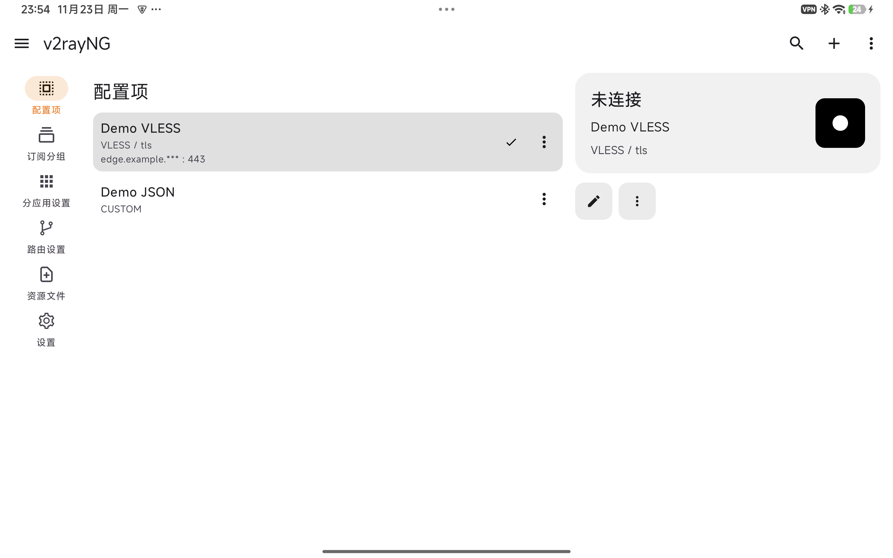
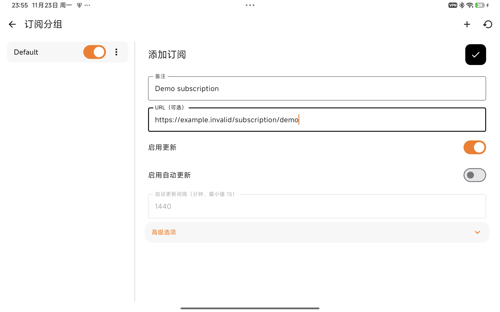
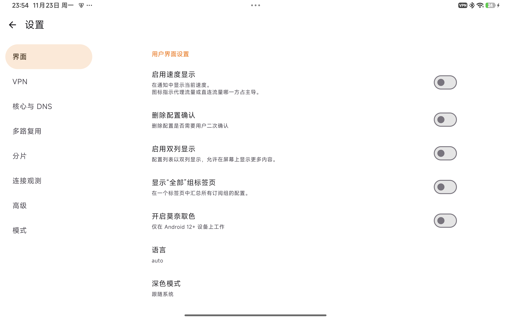
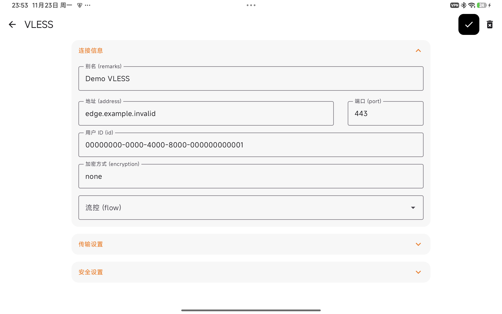
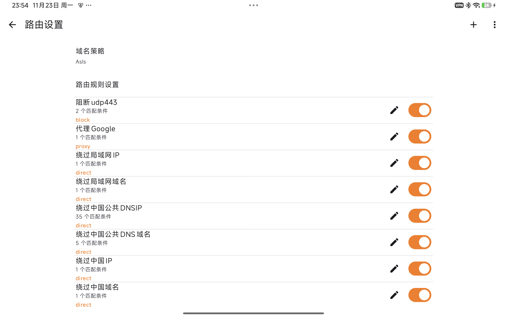
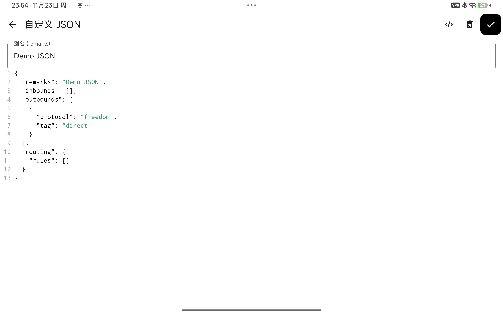

# v2rayNG · Graphite UI

本仓库是 [2dust/v2rayNG](https://github.com/2dust/v2rayNG) 的 UI 改版分支，围绕手机、平板和电视的不同操作方式调整布局，并修复配置管理、订阅编辑和应用列表授权中的问题。

定制构建使用包名 **`org.ktx.v2ray`**，可与上游的 `com.v2ray.ang` 同时安装。通过 Gradle 参数 `-PcustomPackage=true` 启用定制包名和新的 Graphite 启动图标。

This fork adapts v2rayNG's Compose UI for phones, tablets and TV navigation. Custom builds use `org.ktx.v2ray` and a Graphite launcher icon when built with `-PcustomPackage=true`.

## 本项目的改版内容

| 区域 | 当前实现 |
| --- | --- |
| 首页与导航 | Graphite 主题与浅色/深色支持、紧凑连接状态卡；宽屏使用侧边导航，手机保留底部导航；空配置页面提供订阅和导入入口。 |
| 按钮与表单 | 启动、测速、编辑、保存等操作使用带无障碍名称的图标；节点表单限制阅读宽度，按连接、传输、安全分组，高级选项可折叠，保存入口固定在顶部。 |
| 订阅分组 | 横屏采用分组列表与编辑区双栏；竖屏显示完整编辑页；旋转屏幕后保留输入草稿与展开状态。 |
| 设置与路由 | 宽屏设置使用分类侧栏；路由列表显示条件数量摘要，开关带规则名称；编辑与重排按规则 ID 对应目标。 |
| 导入与 JSON | 导入失败保留原文并显示原因；手动创建入口按协议选择；JSON 编辑器提供格式化、语法着色和格式错误位置提示。 |
| 应用列表与删除 | 为小米的应用列表权限提供授权及重试入口；未连接时允许删除当前选中配置，运行中的节点保留删除保护。 |
| 辅助页面 | 调整资源、备份、更新、关于等页面的内容宽度，补充日志空状态，并让许可证弹窗跟随浅色与深色主题。 |

改版背景与设备适配目标见 [UI 改版计划](docs/v2rayng-ui-tv-refactor-plan.md)。

## 最新 UI · 平板实机截图

以下截图于 **2026-11-23** 截取自小米平板（Android 15），展示当前定制版的横屏浅色界面。节点和订阅内容为演示数据，使用 `example.invalid` 保留域名，不包含有效代理凭据或可用订阅；截图中的示例不用于连接测试。

### 首页与连接状态

节点列表、连接状态和常用操作并列显示，侧边导航可直接进入主要管理页面。



### 管理与编辑

| 订阅分组 · 列表与编辑区 | 设置 · 分类侧栏 |
| --- | --- |
|  |  |

| 节点编辑 · 分组与固定保存入口 | 路由规则 · 条件摘要与独立开关 |
| --- | --- |
|  |  |

### 自定义 JSON

格式化与保存入口位于顶栏，编辑区显示行号和语法颜色。



### 验证范围

- 167 项 JVM 单元测试通过，Play Store 与 F-Droid 的 ARM64 Debug 构建及 lint 检查通过。
- 当前平板已检查横竖屏草稿保留、浅色/深色与动态色组合、导入失败提示、配置保存与删除，以及公共开关的触摸、Enter、空格和方向键确认操作。
- **Not run**：电视实机遥控器验收（当前无电视设备）；完整 TalkBack 播报与激活验收（系统语音引擎首次设置阻挡，且无设备音频回传）；所有页面和协议逐项焦点/输入法验收（当前检查覆盖公共组件及代表性表单）。
- **Not run**：真实运行节点的删除保护与 VPN 连通性（没有配置有效测试节点，删除保护逻辑由单元测试覆盖）；路由拖动后焦点恢复（规则身份逻辑已由单元测试覆盖，未在实机改动既有规则顺序）；非小米及 Android 13 以下设备的权限回退运行验证（当前只有 Android 15 小米平板）。

## Upstream / 上游项目

A V2Ray client for Android, support [Xray core](https://github.com/XTLS/Xray-core) and [v2fly core](https://github.com/v2fly/v2ray-core)

以下徽章、下载、Wiki 和社区链接属于上游项目。

[](https://developer.android.com/about/versions/lollipop)
[](https://kotlinlang.org)
[](https://github.com/2dust/v2rayNG/commits/master)
[](https://www.codefactor.io/repository/github/2dust/v2rayng)
[](https://github.com/2dust/v2rayNG/releases)
[](https://t.me/v2rayn)

---

## Upstream download / 上游下载

下方链接提供上游发行包。本 README 展示的 UI 与定制图标需构建本仓库的相应分支获得；准备原生构建输入时请参照 [构建工作流](.github/workflows/build.yml)。

Download the latest release here:

在这里下载最新版本：

[https://github.com/2dust/v2rayNG/releases](https://github.com/2dust/v2rayNG/releases)

> [!TIP]
> v2rayNG is the mobile version. For the desktop version, please visit the v2rayN \
> v2rayNG 是手机版，电脑版请访问 v2rayN
>
> https://github.com/2dust/v2rayN

---

### Geoip and Geosite

- geoip.dat and geosite.dat files are in `Android/data/com.v2ray.ang/files/assets` (path may differ on some Android device)
- download feature will get enhanced version in this [repo](https://github.com/Loyalsoldier/v2ray-rules-dat) (note: it needs a working proxy)
- latest official [domain list](https://github.com/Loyalsoldier/v2ray-rules-dat) and [ip list](https://github.com/Loyalsoldier/geoip) can be imported manually
- possible to use a third-party dat file in the same folder, like [h2y](https://guide.v2fly.org/routing/sitedata.html#%E5%A4%96%E7%BD%AE%E7%9A%84%E5%9F%9F%E5%90%8D%E6%96%87%E4%BB%B6)

More in our [wiki](https://github.com/2dust/v2rayNG/wiki)

### Geoip 与 Geosite

- geoip.dat 和 geosite.dat 文件位于 `Android/data/com.v2ray.ang/files/assets`（部分设备路径可能不同）
- 下载功能将获取该 [仓库](https://github.com/Loyalsoldier/v2ray-rules-dat) 中的增强版本（注意：此功能需要一个可用的代理）
- 最新官方 [域名列表](https://github.com/Loyalsoldier/v2ray-rules-dat) 和 [IP 列表](https://github.com/Loyalsoldier/geoip) 可手动导入
- 也可在同一文件夹中使用第三方 dat 文件，例如 [h2y](https://guide.v2fly.org/routing/sitedata.html#%E5%A4%96%E7%BD%AE%E7%9A%84%E5%9F%9F%E5%90%8D%E6%96%87%E4%BB%B6)

更多内容请见我们的 [wiki](https://github.com/2dust/v2rayNG/wiki)

---

## Development guide / 开发指南

### Note

- Android project under the V2rayNG folder can be compiled directly in Android Studio, or using the Gradle wrapper. But the v2ray core inside the aar is (probably) outdated.
- The aar can be compiled from the Golang project [AndroidLibV2rayLite](https://github.com/2dust/AndroidLibV2rayLite) or [AndroidLibXrayLite](https://github.com/2dust/AndroidLibXrayLite). For a quick start, read the guides for [Go Mobile](https://github.com/golang/go/wiki/Mobile) and [Makefiles for Go Developers](https://tutorialedge.net/golang/makefiles-for-go-developers/).
- v2rayNG can run on Android Emulators. For WSA, VPN permission needs to be granted via `appops set [package name] ACTIVATE_VPN allow`.

### 提示

- V2rayNG 文件夹下的 Android 项目可直接在 Android Studio 中编译，或使用 Gradle wrapper 编译。但 aar 内置的 v2ray core（可能）已过时。
- aar 可由 Golang 项目 [AndroidLibV2rayLite](https://github.com/2dust/AndroidLibV2rayLite) 或 [AndroidLibXrayLite](https://github.com/2dust/AndroidLibXrayLite) 编译而成。快速入门可参考 [Go Mobile](https://github.com/golang/go/wiki/Mobile) 指南和 [Makefiles for Go Developers](https://tutorialedge.net/golang/makefiles-for-go-developers/)。
- v2rayNG 可在 Android 模拟器上运行。对于 WSA，需要通过 `appops set [package name] ACTIVATE_VPN allow` 授予 VPN 权限。

---


## Upstream GPG Verification / 上游 GPG 签名校验

以下公钥用于上游发行文件，不用于本仓库的本地 Debug 构建。

Release files are signed with GPG to verify authenticity and integrity, helping prevent mirror, ISP, or CDN hijacking.

发布文件已使用 GPG 签名，可用于校验文件真实性与完整性，预防镜像站、运营商或 CDN 劫持。

### Fingerprint / 公钥指纹

```text
7694 5E9F 3E9A 168F 8070 F195 805D 661C
134D FAF6 8903 C199 463C 31E5 AE90 3AE0
```

---

## Community / 社区

Telegram Group / Telegram 群组：

[https://t.me/v2rayN](https://t.me/v2rayN)

Telegram Channel / Telegram 频道：

[https://t.me/github_2dust](https://t.me/github_2dust)
